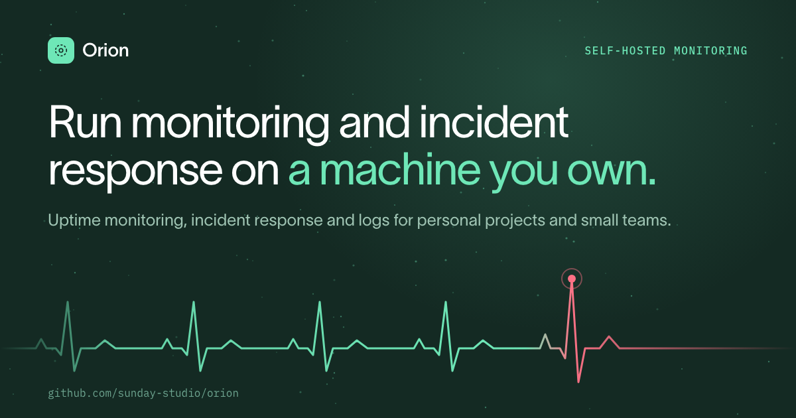
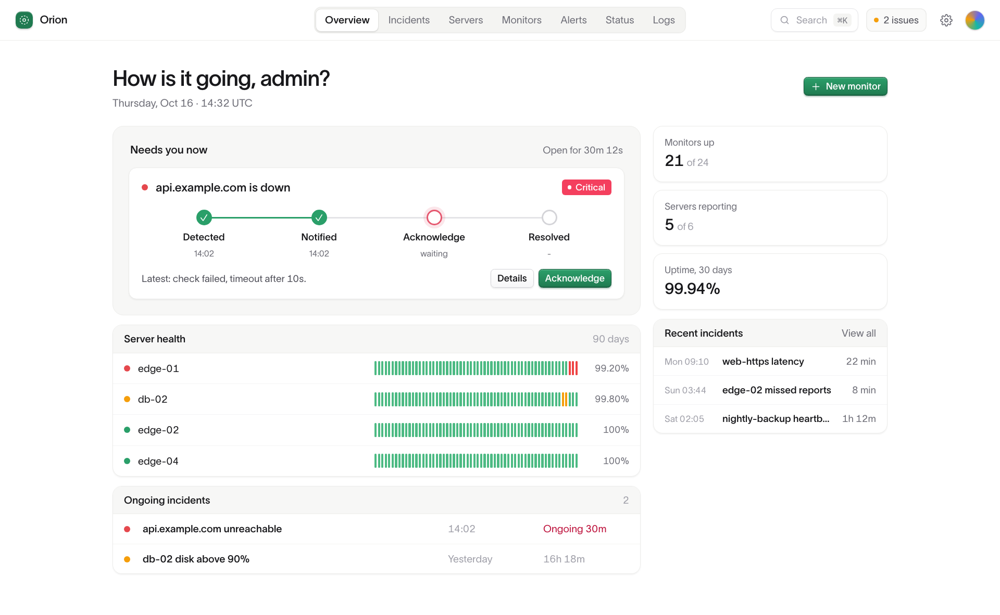
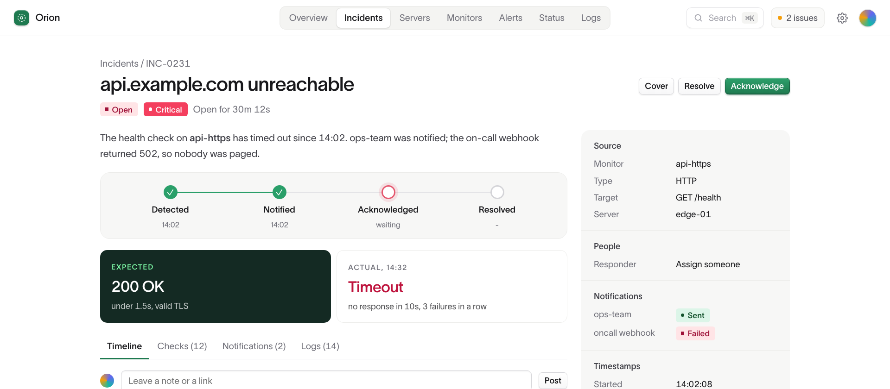

# Orion

[](https://github.com/sunday-studio/orion/actions/workflows/ci.yml)

<p align="center">
  
</p>

**Self-hosted monitoring, incident response and logs for personal projects and small teams.**

Run Orion on a machine you own. When something breaks you hear it first, and every byte stays on your
server. There is no hosted version and no account to create.

<table>
  <tr>
    <td width="50%">
      <picture>
        <source media="(prefers-color-scheme: dark)" srcset="assets/console-overview-dark.png">
        
      </picture>
      <sub><b>Overview</b>: what needs you now, and how your servers are doing</sub>
    </td>
    <td width="50%">
      <picture>
        <source media="(prefers-color-scheme: dark)" srcset="assets/console-incident-detail-dark.png">
        
      </picture>
      <sub><b>Incidents</b> with a timeline and who was told</sub>
    </td>
  </tr>
</table>

## What you get

- **Monitors** for HTTP endpoints, websites, TCP ports, Docker containers, systemd services, PM2
  processes, commands and resource thresholds.
- **Incidents** opened automatically when a monitor fails, with a timeline of what failed, who was told
  and who acknowledged.
- **Alerts** routed by rule to webhook or email, with every delivery recorded and failed ones retried.
- **Logs** from your own apps over JSON or OpenTelemetry, searchable next to the incident.
- **Status pages** you can publish for the people who depend on you.
- **One small footprint:** one API process, a monitor worker, SQLite, and the bundled Console. Back it up
  as ordinary files.

## Why Orion?

Most uptime tools run checks from outside your network. That is useful, but it cannot see local service
state, Docker containers, systemd units, PM2 processes, command checks, or the machine's own resource
pressure.

Orion keeps that local context on the monitored host. Each Server runs next to the services it watches
and reports to a Core you control, so you can run it from Docker Compose without adopting Prometheus,
Postgres, Kubernetes or a hosted observability stack first.

## Get started

About ten minutes on a Linux or macOS machine with Docker. The full steps, with every command, are in
[Getting started](docs/getting-started.md).

1. **Start Core** with Docker Compose and sign in to the Console on port `8999`.
2. **Connect a server** with the one-line installer on any Linux or macOS host you want to watch.
3. **Add a monitor and an alert channel**, then send a test message.

Setting up a new server? [Set up Core with Docker](docs/deployment/docker-new-server.md) builds Core and
the Console from source in one command; then connect servers with the installer.

Want to see it work before installing anything? The demo starts Core, monitors a tiny Python service,
breaks it and checks recovery:

```sh
examples/python-sleep-compose/smoke.sh
```

## Documentation

The full map is in [docs/README.md](docs/README.md). The most useful pages:

| | |
|---|---|
| **Start** | [Getting started](docs/getting-started.md) · [How Orion works](docs/how-it-works.md) |
| **Run it** | [Deployment guide](docs/deployment/README.md) · [Core Docker deployment](docs/deployment/core-docker.md) · [Core security defaults](docs/deployment/core-security-defaults.md) · [Server install and upgrade](docs/deployment/node-install-upgrade.md) · [Server CLI cheat sheet](docs/deployment/server-cli-cheatsheet.md) |
| **Your data** | [Send logs from your apps](docs/product-logs.md) · [SQLite backup and restore](docs/sqlite-backup-restore.md) |
| **Build** | [Local development](docs/development/local-development.md) · [Architecture](docs/architecture/system-overview.md) · [System design](docs/system-design.md) |

## Project layout

```txt
orion/
├── apps/
│   ├── node/    # Go Server daemon and orion-node compatibility CLI
│   ├── core/     # Go API server, SQLite, OpenAPI, embedded Console
│   ├── console/  # React/Vite UI source
│   └── website/  # Astro site and documentation
├── deploy/       # Docker Compose, systemd, launchd, install scripts
├── docs/         # architecture, deployment, development, milestones
├── packages/     # shared/generated package space
└── Makefile
```
