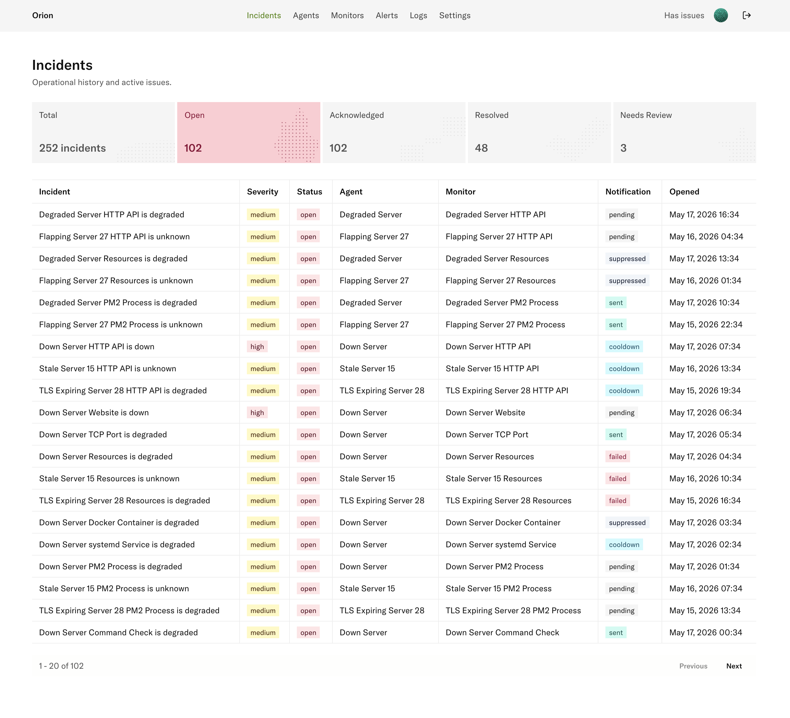
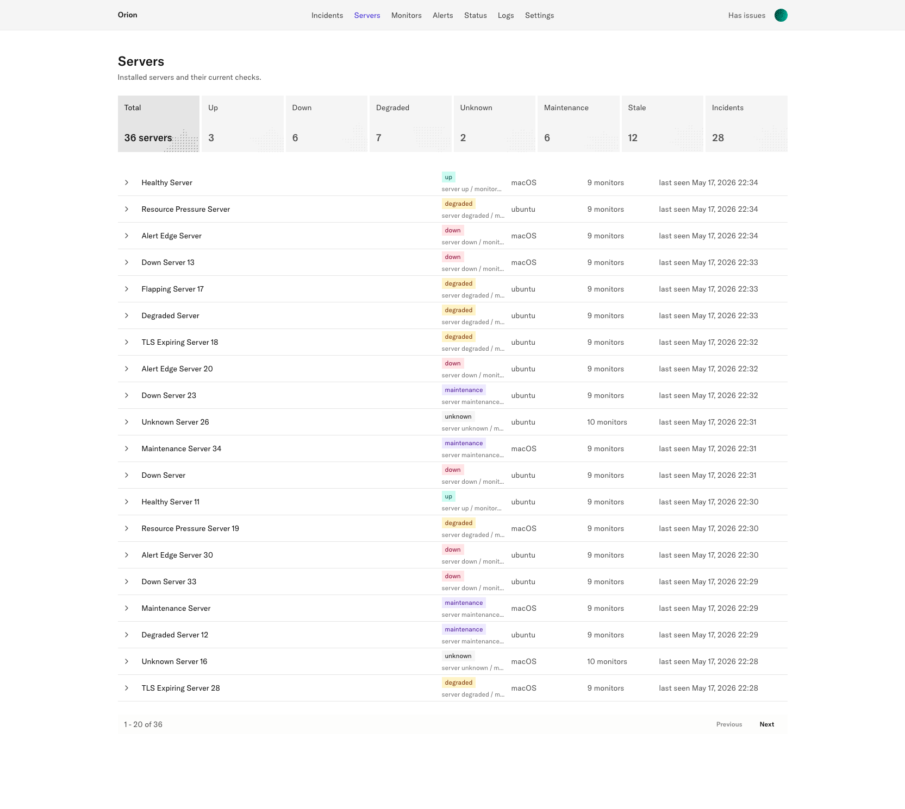
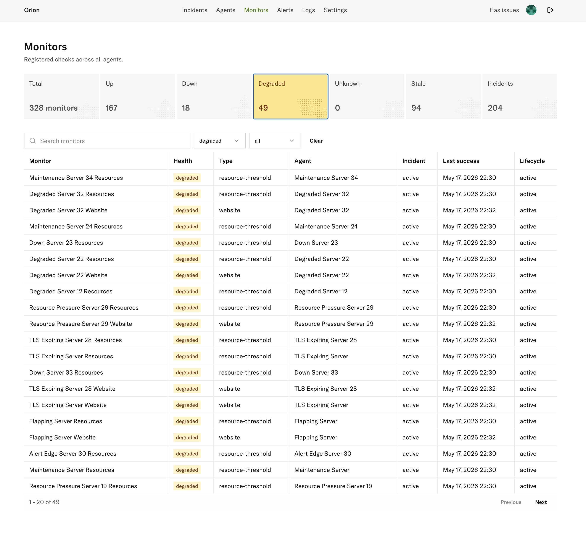
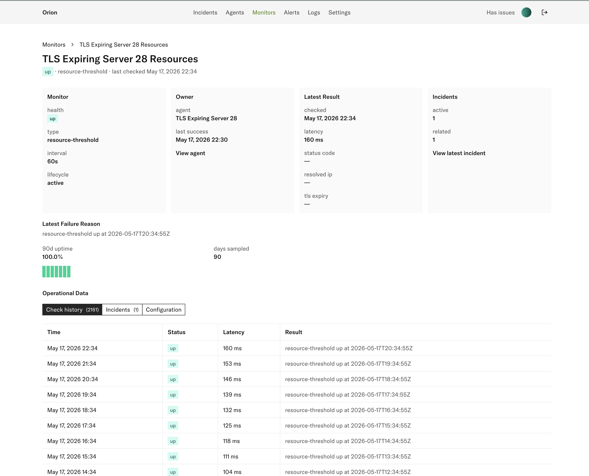
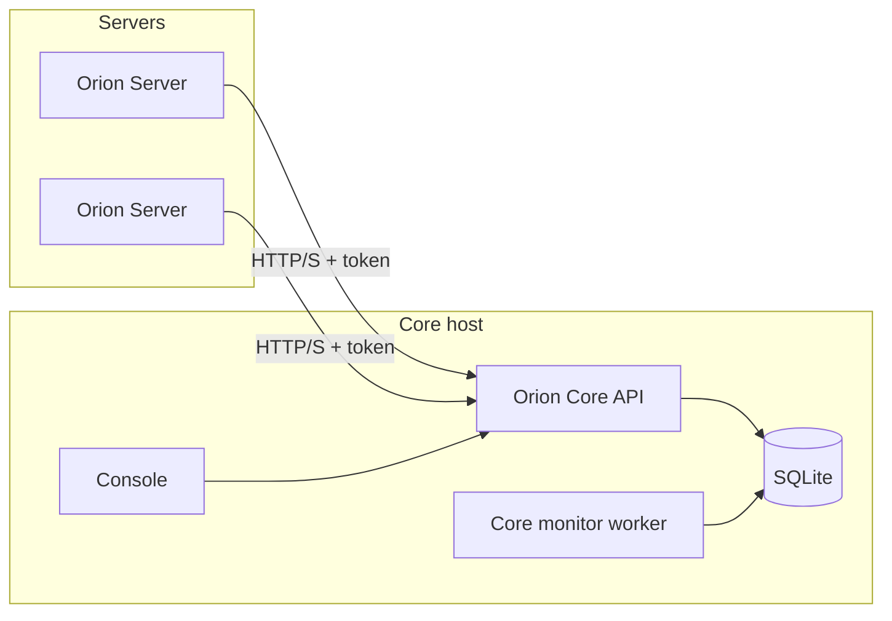

# Orion

[](https://github.com/sunday-studio/orion/actions/workflows/ci.yml)

**Self-hosted monitoring, incident response and logs for personal projects and small teams.**

Run Orion on a machine you own. When something breaks you hear it first, and every byte stays on your
server. There is no hosted version and no account to create.

| Incidents | Servers |
|---|---|
|  |  |

| Monitors | Monitor detail |
|---|---|
|  |  |

## What you get

- **Monitors** for HTTP endpoints, websites, TCP ports, Docker containers, systemd services, PM2
  processes, commands and resource thresholds.
- **Incidents** opened automatically when a monitor fails, with a timeline of what failed, who was told
  and who acknowledged.
- **Alerts** routed by rule to webhook or email, with every delivery recorded and failed ones retried.
- **Logs** from your own apps over JSON or OpenTelemetry, searchable next to the incident.
- **Status pages** you can publish for the people who depend on you.
- **One small footprint:** one API process, a monitor worker, SQLite, and the bundled Console. Back it up
  as ordinary files.

## Why Orion?

Most uptime tools run checks from outside your network. That is useful, but it cannot see local service
state, Docker containers, systemd units, PM2 processes, command checks, or the machine's own resource
pressure.

Orion keeps that local context on the monitored host. Each Server runs next to the services it watches
and reports to a Core you control, so you can run it from Docker Compose without adopting Prometheus,
Postgres, Kubernetes or a hosted observability stack first.

## Quickstart

About ten minutes, on a Linux or macOS machine with Docker.

**1. Start Core.**

```sh
curl -fsSL -o orion-compose.yml \
  https://raw.githubusercontent.com/sunday-studio/orion/main/deploy/docker-compose.yml

ADMIN_PASSWORD="$(openssl rand -base64 24)"
JWT_SECRET="$(openssl rand -base64 32)"

cat > .env <<'EOF'
ORION_CORE_IMAGE=ghcr.io/sunday-studio/orion-core:<version>
ORION_HTTP_PORT=8999
ORION_REQUIRE_FRONTEND_AUTH=true
ORION_ADMIN_USERNAME=admin
EOF
printf 'ORION_ADMIN_PASSWORD=%s\nORION_JWT_SECRET=%s\n' "$ADMIN_PASSWORD" "$JWT_SECRET" >> .env

docker compose -f orion-compose.yml up -d
```

Open `http://localhost:8999` and sign in with `admin` and the password in `.env`.

**2. Connect a server.** Run this on any Linux or macOS host you want to watch, using a Core URL that host
can reach:

```sh
curl -fsSL https://github.com/sunday-studio/orion/releases/latest/download/orion-agent-installer.sh | bash -s -- \
  --core-url https://core.your-domain.tld
```

**3. Add a monitor and an alert channel** in the Console, then send a test message.

Want to see it work before installing anything? Run the demo:
[examples/python-sleep-compose](examples/python-sleep-compose/) starts Core, monitors a tiny Python
service, breaks it, and checks recovery.

```sh
examples/python-sleep-compose/smoke.sh
```

## How it works



- **Server** runs on Linux and macOS hosts and reports system metrics and monitor results.
- **Core** receives reports, stores data, derives health, opens incidents, sends alerts and serves the API.
- **Core monitor worker** runs Core-managed checks in its own process, so API health stays separate from
  monitor execution health.
- **Console** is the web UI for incidents, servers, monitors, alerts, logs and settings.

> **Terminology.** Product copy says *Server*. The historical `agent` name remains in compatibility
> surfaces: the `orion-agent` binary, install assets, `/v1/agents` routes, SDK symbols and SQLite
> tables. See the [Server terminology decision](docs/architecture/server-terminology.md).

## Deploy

### Core

Core ships as one Docker image that runs as two services sharing a `/data` volume: the API with the
Console, and the monitor worker. Put it somewhere your Servers can always reach, such as a small VPS, a
Tailscale-reachable host, or a home server that is more reliable than the things it watches.

Good to know:

- `ORION_REQUIRE_FRONTEND_AUTH=true` makes Core refuse to start unless login is configured with an admin
  password of at least 12 characters and a JWT secret of at least 32. Keep both out of source control.
- Behind a reverse proxy, set `ORION_TRUSTED_PROXIES` to the proxy address so rate limits see real client
  IPs. Without it Core ignores `X-Forwarded-For`.
- Core refuses to start with no admin credentials. For local experiments only, set
  `ORION_ALLOW_INSECURE_NO_AUTH=true`; every admin route is then open to anyone who can reach the port.
- Swagger UI is off unless `ORION_ENABLE_SWAGGER=true`.
- Request bodies are limited (1 MiB, 5 MiB for log batches), and URL paths with embedded tokens are not
  logged.
- Public status page subscriber email uses its own sender (`ORION_PUBLIC_STATUS_MAIL_*`). Internal alerts
  are delivered through alert rules, not that SMTP setup.

Plain `docker run` commands, backup, CORS and upgrades are in
[Core Docker deployment](docs/deployment/core-docker.md).

### Server

The installer creates an editable config and starts the service. Pin a release for reproducible
installs:

```sh
curl -fsSL https://github.com/sunday-studio/orion/releases/latest/download/orion-agent-installer.sh | bash -s -- \
  --version 0.1.2 \
  --core-url https://core.your-domain.tld
```

| | Linux | macOS |
|---|---|---|
| Config | `/etc/orion/config.yaml` | `/usr/local/etc/orion/config.yaml` |
| State | `/var/lib/orion/state.db` | `/usr/local/var/lib/orion/state.db` |
| Log | `/var/log/orion/agent.log` | `/usr/local/var/log/orion/agent.log` |

The default config has the Core URL, a 60 s reporting interval, location collection off and no
monitors. Add checks to it when you are ready. Do not delete `state.db` during an upgrade: it holds the
Server identity, token, maintenance state and monitor mapping.

Service logs, rollback, Docker monitor permissions and local-network notes are in
[Server install and upgrade](docs/deployment/agent-install-upgrade.md).

## Operate

| Command | What it does |
|---|---|
| `orion-agent status` | Show whether the service is running and connected to Core. |
| `orion-agent doctor` | Check config, connectivity and the service, and suggest fixes. |
| `orion-agent logs` | Show recent entries. Add `--level error` or `--since 1h`. |
| `orion-agent restart` | Restart the service after editing the config. |
| `orion-agent update` | Update the binary, keeping config and state. `-version 0.1.2` pins a version. |
| `orion-agent reconfigure` | Create a new registration. Use it only if you change `core_url` or need a new identity. |

Add `--json` to `status`, `doctor` and `config show` for automation. To try a single collection cycle,
run `orion-agent run -once` (add `-verbose` when debugging registration or transport). Editing monitors
in the config does not need a reinstall: restart the service and it reconciles monitors by name.

## Monitor types

HTTP health checks, websites, TCP ports, resource thresholds, Docker containers, systemd services, PM2
processes, commands and internal services. See [Server monitors](docs/architecture/agent-monitors.md) for
config details.

## Develop

Run the bundled Core and Console example from this repository:

```sh
cd deploy/examples
ADMIN_PASSWORD="$(openssl rand -base64 24)"
JWT_SECRET="$(openssl rand -base64 32)"
cat > .env <<EOF
ORION_REQUIRE_FRONTEND_AUTH=true
ORION_ADMIN_USERNAME=admin
ORION_ADMIN_PASSWORD=$ADMIN_PASSWORD
ORION_JWT_SECRET=$JWT_SECRET
EOF
docker compose -f ./core-console-compose.yaml up -d
curl http://localhost:8999/health
```

Work on the Console against a local Core:

```sh
cd apps/console
npm install
npm run dev        # set VITE_API_BASE_URL=http://localhost:8999/v1 in apps/console/.env
```

Seed demo data into `apps/core/data/orion.db` with `make seed-demo-data`.

Tests and builds:

```sh
cd apps/core && go test ./...
make core-worker-build
cd apps/agent && go test ./...
cd apps/console && npm run build
```

OpenAPI is generated from Core route annotations. Regenerate with `make generate-openapi` and
`make generate-sdk`; do not edit `apps/core/openapi.yaml` or the generated Console SDK by hand. Build a
Server binary with `make agent-build VERSION=0.1.2`.

The public site and documentation live in [apps/website](apps/website/).

## Documentation

**Run it:** [Deployment guide](docs/deployment/README.md) ·
[Core Docker deployment](docs/deployment/core-docker.md) ·
[Server install and upgrade](docs/deployment/agent-install-upgrade.md) ·
[Kubernetes position](docs/deployment/kubernetes-position.md) ·
[Release readiness gate](docs/deployment/release-readiness.md)

**How it works:** [System design](docs/system-design.md) ·
[Architecture overview](docs/architecture/system-overview.md) ·
[Core features](docs/architecture/core-features.md) ·
[Data ingestion](docs/architecture/data-ingestion.md) ·
[Persistence and lifecycle](docs/architecture/persistence-and-lifecycle.md) ·
[Incident reconciliation](docs/architecture/incident-reconciliation-flow.md)

**Contribute:** [Incident readiness PR checklist](docs/development/incident-readiness-pr-checklist.md) ·
[Seed demo data](docs/development/seed-demo-data.md) · [Milestones](docs/milestones/README.md)

## Project layout

```txt
orion/
├── apps/
│   ├── agent/    # Go Server daemon and orion-agent compatibility CLI
│   ├── core/     # Go API server, SQLite, OpenAPI, embedded Console
│   ├── console/  # React/Vite UI source
│   └── website/  # Astro site and documentation
├── deploy/       # Docker Compose, systemd, launchd, install scripts
├── docs/         # architecture, deployment, development, milestones
├── packages/     # shared/generated package space
└── Makefile
```
