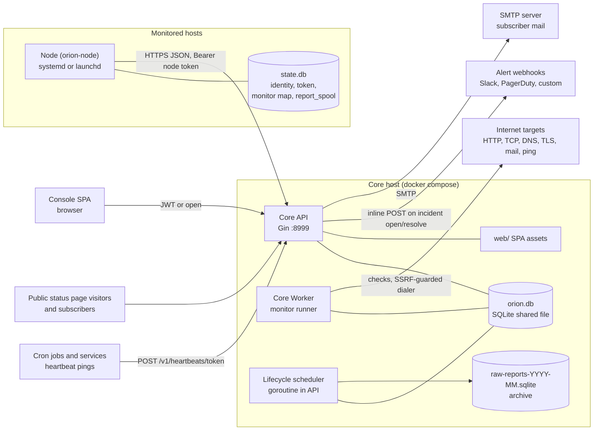
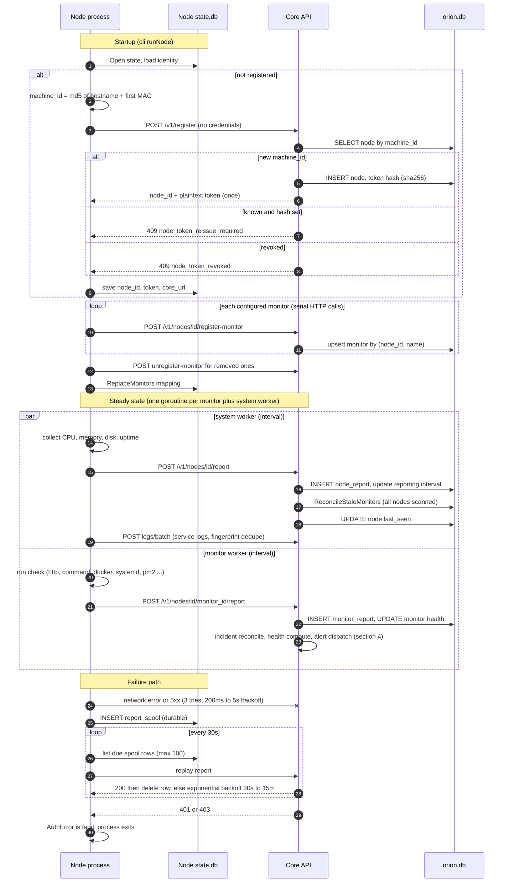
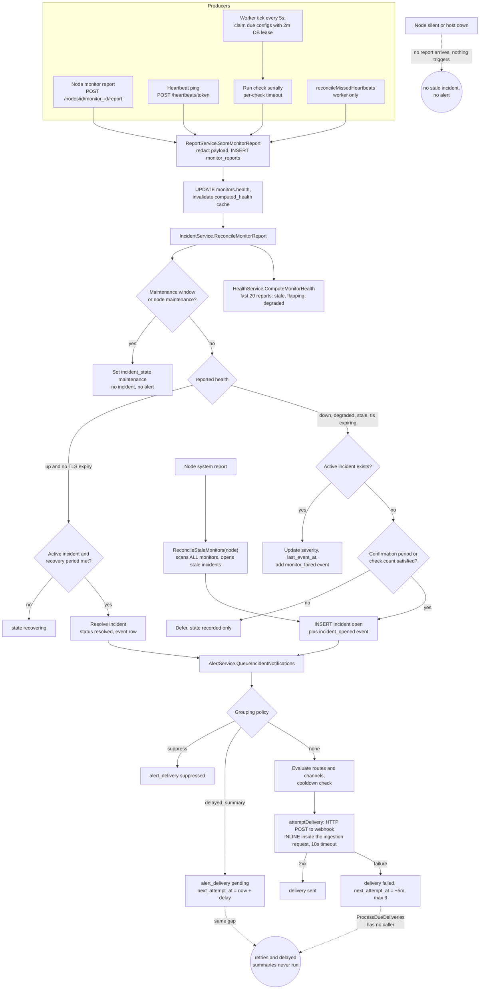
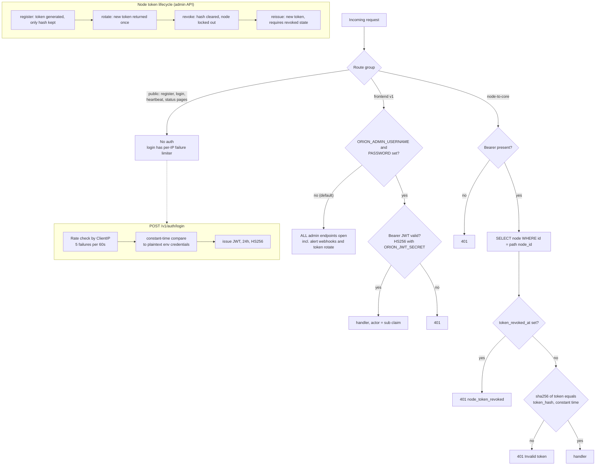
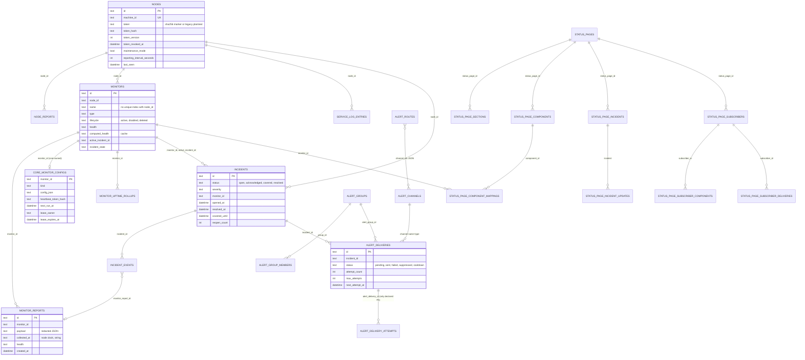
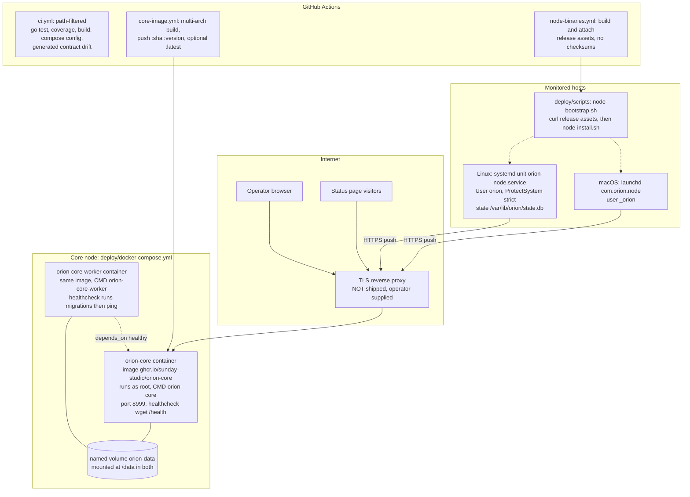

# Orion Backend Architecture

Status: read-only audit snapshot, 2026-10-14, `main` @ `810ac82`.
Scope: `apps/node/`, `apps/core/`, `deploy/`, `Makefile`, `docs/node-core-contract.md`.
Companion: [backend-gaps-and-improvements.md](backend-gaps-and-improvements.md).

Terminology: the code and API say **Node**; older docs (`docs/node-core-contract.md`, `docs/system-design.md`) say **Server**. They are the same thing.

## 1. Components at a glance

| Component | Binary / entry point | Language / stack | Responsibility |
|---|---|---|---|
| Node | `apps/node/main.go` -> `internal/cli` | Go, gopsutil, GORM + SQLite (state only) | Registers with Core, collects host metrics and per-monitor checks, spools and ships reports and service logs |
| Core API | `apps/core/cmd/api/main.go` | Go 1.25, Gin, GORM, mattn/go-sqlite3 (CGO), golang-jwt | REST API, ingestion, health computation, incidents, alerts, status pages, serves the Console SPA from `./web` |
| Core Worker | `apps/core/cmd/worker/main.go` | Go, same module | Claims due Core-managed monitor configs under a DB lease, runs checks (http, tcp, dns, tls, udp, ping, mail, api_request, domain_expiration, synthetic, playwright), reconciles missed heartbeats, writes worker heartbeats |
| Data lifecycle scheduler | goroutine inside Core API (`service/data-lifecycle-scheduler-service.go`) | Go | Hourly rollup, raw report archive, subscriber privacy retention |
| Console | `apps/console` (React/Vite) | TypeScript | UI, built into `apps/core/web` |
| Storage | one SQLite file `${ORION_DATA_DIR}/orion.db` shared by API and Worker processes | SQLite via GORM, 26 embedded SQL migrations, about 28 live tables | System of record. Archive files `raw-reports-YYYY-MM.sqlite` beside it |

Request lifecycle (Core API): `gin.Default()` (Logger + Recovery) -> CORS -> second `gin.Logger()` + `gin.Recovery()` -> `RequestIDMiddleware` -> `RuntimeDiagnosticsMiddleware` (in-memory latency and status counters) -> route group middleware -> handler -> service -> GORM -> SQLite. Unmatched `GET`/`HEAD` falls through to `NoRoute` and serves the SPA (`routes.go:220`).

Route groups (`internal/api/routes.go`):

| Group | Auth | Examples |
|---|---|---|
| Public status pages | none | `/status/:slug`, `/status/:slug/subscribers`, `/feed.atom`, `/` (custom domain) |
| Public v1 | none | `POST /v1/register`, `POST /v1/auth/login`, `POST /v1/heartbeats/:token[/success|/failure]` (token in path) |
| Frontend v1 | JWT only if `ORION_ADMIN_*` set, otherwise open | all `/v1/nodes`, `/v1/monitors`, `/v1/incidents`, `/v1/alerts/*`, `/v1/settings/*`, status page admin |
| Node-to-Core | `Authorization: Bearer <node token>` + path `node_id` match | `/v1/nodes/:node_id/{register-monitor,unregister-monitor,report,logs/batch,:monitor_id/report,maintenance}` |
| Docs / health | none | `/swagger/*`, `/health` |

## 2. System overview

Key fact for reading everything below: Node-owned monitors only produce data when the Node pushes. Core-owned monitors are pulled by the Worker. Both converge on `ReportService.StoreMonitorReport`, which is the single choke point for health, incident and alert logic.

## 3. Node registration and reporting

Source: `apps/node/internal/registration/registration.go`, `internal/node.go`, `internal/reporting.go`, `internal/state/report-spool.go`, `internal/transport/client.go`; Core `api/node.go`, `service/node-service.go`, `api/report.go`, `service/report-service.go`.

Authentication detail: `AuthMiddleware` extracts the bearer, then `ValidateNodeToken` loads the node row by `node_id`, rejects revoked nodes, and compares `sha256(token)` to `nodes.token_hash` in constant time. Legacy rows with an empty hash fall back to comparing the raw `nodes.token` column.

## 4. Monitor check -> health -> incident -> alert

Source: `worker/app.go`, `service/core-monitor-scheduler-service.go`, `service/report-service.go`, `service/incident-service.go`, `service/incident-state-service.go`, `service/health-service.go`, `service/alert-service.go`, `service/alert-delivery-service.go`.

Dashed edges are gaps found in this audit, see findings `ORB-001` and `ORB-002`.

Health model (`service/health-service.go`):

| State | Rule |
|---|---|
| `stale` | newest report older than `max(5 min, 5 x reporting_interval)`, measured from the node-supplied `collected_at` |
| `degraded` | at least 3 up/down transitions in last 20 reports, or 30% to 99% failures with at least 5 reports |
| `up` / `down` | latest report health otherwise |
| node `stale` | `nodes.last_seen` older than the same window |
| node `maintenance` | `nodes.maintenance_mode` flag (no expiry) |

Node overall health = node availability combined with monitor rollup (all down -> down, any down/degraded/stale -> degraded).

## 5. Auth flow

`ORION_REQUIRE_FRONTEND_AUTH=true` (set in the shipped compose files) refuses to boot without a 12+ char password and 32+ char JWT secret; the binary default is auth off.

## 6. Data model

There are no declared foreign keys, `PRAGMA foreign_keys` is not enabled, and deletes are mostly soft (`deleted_at` or `lifecycle = 'deleted'`). Relationships below are logical only. Core-managed monitors are attached to a synthetic owner node row (`node_core`).

Other tables: `schema_migrations`, `data_lifecycle_settings` (single row id=1), `audit_events`, `core_worker_statuses`.

Retention model: only `node_reports` and `monitor_reports` are archived to monthly SQLite files after `RawReportHotDays` and rolled into `monitor_uptime_rollups`. Nothing prunes `service_log_entries`, `alert_deliveries`, `alert_delivery_attempts`, `incident_events`, `audit_events`, `core_worker_statuses` or the source tables of soft-deleted rows. Subscriber PII has its own retention job.

## 7. Configuration and state

| Surface | Source | Notes |
|---|---|---|
| Core config | env vars (`ORION_*`) plus optional `.env` in CWD (`config.LoadDotEnv`) | validated in `Config.Validate()`; invalid ints and bools silently fall back to defaults (`getEnvInt`, `getEnvBool`) |
| Core data | `${ORION_DATA_DIR}/orion.db` | opened by both API and Worker; both run migrations at startup |
| Node config | YAML (`config.yaml`), validated by `internal/config/validators.go` | monitors, interval, `core_url`, logging, geo opt-in |
| Node state | SQLite `state.db` with `0600` file and `0700` dir | stores node id, plaintext bearer token, monitor mapping, maintenance flag, `report_spool` |
| Runtime tuning | `data_lifecycle_settings` row, edited from Console | hot days, rollups, archive schedule |

## 8. Deployment and runtime topology

Notes on topology:

- API and Worker are separate processes sharing one SQLite file; scaling out horizontally means moving off SQLite or running a single node.
- The compose file passes `ORION_ADMIN_*` and `ORION_JWT_SECRET` to the Worker too, although the Worker does not authenticate users.
- There is no log shipping, metrics endpoint or tracing; observability is JSON slog on stdout, GORM SQL logs on stdout, and in-memory diagnostics served at `/v1/diagnostics/core` and `/v1/diagnostics/core-worker`.
- Release gate `make release-readiness` = `node-test core-test release-core-build console-build repository-smoke`. `make core-backend-verify` adds race, golangci-lint, govulncheck and contract drift, but CI does not run those three extra gates (see findings).

## 9. Package map (Core)

| Package | Role | Biggest files |
|---|---|---|
| `internal/api` | Gin handlers, DTO mapping, routes, rate limiter, status page HTML | `monitor.go` 462, `routes.go` 358 |
| `internal/service` | business logic (nodes, tokens, reports, health, incidents, alerts, archive, rollups, settings, audit, diagnostics, status page subscribers) | `runtime-diagnostics-service.go` 482, `monitor-service.go` 474 |
| `internal/worker` | check runners and the scheduler loop | `app.go` 460, `playwright_runner.go` 461 |
| `internal/db` | GORM models, embedded migrations, init | `models.go` 447 |
| `internal/monitorvalidation` | Core monitor config validation and redaction | no tests |
| `internal/config`, `internal/shared`, `internal/utils` | config, bootstrap, helpers | |

Package map (Node): `internal/cli` (CLI command surface, install/service/update commands), `internal/collector` (system + monitor collectors), `internal/registration`, `internal/transport`, `internal/state` (SQLite store + report spool), `internal/config`, `internal/logging`, `internal/services`.

All source files respect the 500-line gate (`make code-line-limit` passes; largest is 482).
