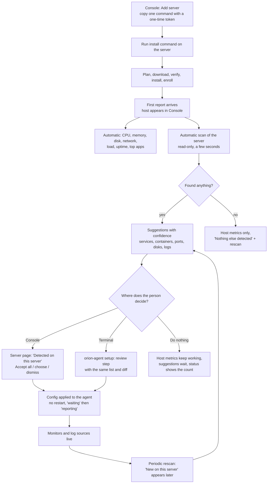

# Agent: install, auto-collect, auto-configure (flow for design)

Status: proposal for the design agent, 2026-10-20. Owner of the behavior: agent thread. Related: [agent-cli-plan.md](../plans/agent-cli-plan.md) (D-016, D-017), [passive-metrics-support-matrix.md](../architecture/passive-metrics-support-matrix.md), [agent-core-contract.md](../agent-core-contract.md).

## The idea in one sentence

A server shows CPU, memory, disk and network the moment the agent is installed, with no setup. Orion then scans the server for what it already knows how to monitor (systemd services, Docker containers, pm2 apps, listening ports, common log files) and proposes the configuration for the person to accept, instead of asking them to write it.

## Principles

1. **Setup is optional.** Per-server CPU, memory, disk, network, load and uptime are collected from the first report. "Setup" only adds things on top. Nothing is blocked behind it.
2. **Orion supports a known set**, so it can find it: systemd units, Docker containers, pm2 apps, listening TCP ports, disks and mounts, common log files, and the processes using the most CPU and memory. The scan reads only; it never changes the server.
3. **Propose, then apply.** High-confidence findings are pre-selected, everything else is one tick away. One "accept" applies the config; no file editing, no restart.
4. **Keep scanning.** New services that appear later (a new container, a new listening port) show up as "new on this server", not silently added.
5. **Same flow everywhere.** The terminal, the Console and the install output tell the same story with the same words.
6. **Always configurable by hand.** Auto-detection is a shortcut, never the only way. A person can write the config file themselves (`config.yaml`, drop-ins in `config.d/`), use `orion-agent config edit`, or create monitors in the Console, with or without ever running a scan. Hand-written entries are never overwritten or duplicated by detection.
7. **Pick and choose.** Nothing is all-or-nothing. A person can turn scanning off entirely, turn off whole kinds (for example "never look at Docker"), skip individual suggestions, and say "never suggest this again". What they decline stays declined.

## The flow

## Screens and what each shows

### 1. Console: Add server (exists; needs one new end state)
- Today: command with token, "waiting for agent", then "connected".
- **New "connected" end state:** the host is live and a panel says what Orion already collects ("CPU, memory, disk, network: reporting") and what it found ("5 things detected, review"). Primary button goes to the server page's Detected panel; secondary "Skip, host metrics are enough".

### 2. Install output in the terminal (artboard `cli-install`)
- Ends with the Doctor box, the link to the server, and one line about detection: `Detected 5 things to monitor. Review: orion-agent setup  or open <console link>`.
- No questions asked during install.

### 3. Console: server page, "Detected on this server" (new)
Where most people will decide. Needs design.
- Grouped list: Services, Containers, Apps (pm2), Ports, Disks, Logs. Each row: name, what Orion will do ("Check it is running", "Alert above 90% full", "Ship its logs"), confidence label (high, medium), a checkbox. High is pre-ticked.
- Header actions: **Accept selected**, **Dismiss all**, **Rescan now**. Footer note: "Applies on the agent's next report. No restart."
- After accept: rows turn into monitors with the existing "waiting" then "reporting" state.
- Log sources need an ingest key (Console app). Row shows "Needs a log key" with an inline "Create key" action; it is not auto-enabled.
- Empty state: "Nothing else detected. Host metrics are on." with Rescan.
- Limited-scan state: "Could not look at Docker (the agent has no access)." with the exact command to grant it, and the trade-off in one line (the access is powerful).
- Notification when new things appear later: a small "2 new on this server" chip on the server row and the page.

### 4. Terminal: `orion-agent setup` (artboard `cli-setup`)
- Optional. Steps: connect (skipped when already enrolled), choose (same list as the Console, same confidence labels, same default ticks), review (the config diff), apply.
- Non-interactive: `--accept-discovered --yes`.

### 5. Terminal: `status` and `doctor`
- `status` shows "Watching 5 monitors" and, when there are pending suggestions, `3 suggestions waiting: orion-agent setup`.
- `doctor` explains scan gaps with the fix command (for example Docker access).

## States to design

| State | What the person sees |
|---|---|
| Installed, scan running | "Looking at this server..." for a few seconds, host metrics already visible |
| Scan found things | Suggestions list, high-confidence ticked |
| Scan found nothing | Host metrics only, rescan action |
| Scan partly blocked | What was skipped, why, exact fix |
| Accepted, waiting | Each new monitor shows "waiting" until its first report |
| Agent offline | Suggestions stay, "applies when the agent reconnects" |
| New thing appears later | "New on this server" with accept or dismiss |
| Dismissed | Hidden, restorable under "Dismissed" |
| Config edited by hand | Hand-written entries are never overwritten; a suggestion that matches one is shown as "already monitored" |
| Scanning turned off | Panel says "Scanning is off" with one switch to turn it on; manual config and Create monitor still work |
| Kind turned off | That group is greyed out with "Not scanned" and its toggle |
| Ignored suggestion | Listed under "Dismissed" with Restore; never reappears on rescan |

## Control: manual config and opting out

| What the person wants | How |
|---|---|
| Write the config themselves | Edit `config.yaml` or add files to `config.d/`; `orion-agent config edit` validates before saving; Console "Create monitor" for checks the agent runs |
| No scanning at all | Setting `discovery.enabled: false` (or a switch in the Console server settings). Host metrics keep working |
| Skip a whole kind | `discovery.kinds` lists what to look at (services, containers, pm2, ports, disks, logs); a toggle per kind in the Console panel and in `orion-agent setup` |
| Skip one thing | Untick it; **Dismiss** hides it. "Never suggest this" adds it to `discovery.ignore`, so a rescan never brings it back |
| Support only some things | Accept only the ticked rows; the rest stay as dismissed or unselected suggestions, restorable later |
| Turn off a collected metric group | Per-app metrics (`app_resources`) and log shipping each have their own switch; host CPU, memory, disk and network stay on |
| Review before anything is written | Accept shows the exact config diff first, in the terminal and in the Console |

Design needs: a Discovery settings block (on/off, per-kind toggles, the ignore list with remove buttons) on the server page, and the same toggles as a step in `orion-agent setup`.

## What the agent does automatically (no one asks)

- Host metrics on from the first report (no config file needed).
- Per-process, per-systemd-unit and per-container CPU, memory and disk I/O (top N, capped), per-container network when Docker is readable.
- The scan on first start, then on a slow schedule and on request.

## What always needs a person

- Accepting monitors (one click, pre-selected for high confidence).
- Log shipping, because it needs a write-only ingest key and logs can contain secrets.
- Anything the agent has no permission to see.

## Decisions for design (and what depends on each)

1. **Auto-apply or propose?** Recommended: propose, with high confidence pre-ticked and one Accept. Fully automatic setup would silently create alerts. (Auto-apply of only "host is up" style monitors is possible later.)
2. **Where is the main decision surface?** Recommended: the Console server page. The terminal stays a full alternative.
3. **How loud are suggestions after the first one?** Recommended: a chip and a count, never a modal.
4. **Log sources:** shown as suggestions but gated on creating a key. Needs a design for creating the key inline.
5. **Where do opt-outs live?** Recommended: per-kind toggles and the ignore list in a "Discovery" settings block on the server page, mirrored in the config file so a hand-edited config and the Console never disagree.
6. **Precedence:** a hand-written config entry always wins over a Console or detected one; show "managed in config file" on such rows so they cannot be edited in two places.

## What this needs from backend (agent thread will build the agent half)

- A way for the agent to **report discoveries** to Core (a list of candidates with kind, name, detail, confidence) and for Core to store and serve them to the Console, plus accept and dismiss actions.
- **More agent check types in monitor definitions.** Core accepts disk, memory, process and port today. Discovery also proposes systemd unit, Docker container and pm2 app checks, which the agent already runs from its config but Core cannot define yet.
- Persist the person's choices (scan on/off, kinds, ignore list) so the Console and the agent config agree.
- The accept action turns a suggestion into a monitor definition, which the agent already pulls every minute, so "applies on the next report" needs no new agent protocol.
