# How Orion works

<picture>
  <source media="(prefers-color-scheme: dark)" srcset="../assets/architecture-dark.svg">
  
</picture>

- **Server** runs on Linux and macOS hosts and reports system metrics and monitor results.
- **Your apps** send logs to Core with a write-only ingest key, as JSON or OpenTelemetry.
- **Core** receives reports, stores data, derives health, opens incidents, sends alerts and serves the API.
- **Core monitor worker** runs Core-managed checks in its own process, so API health stays separate from
  monitor execution health.
- **Console** is the web UI for incidents, servers, monitors, alerts, logs and settings.

> **Terminology.** Product copy says *Server*. The historical `node` name remains in compatibility
> surfaces: the `orion-node` binary, install assets, `/v1/nodes` routes, SDK symbols and SQLite
> tables. See the [Server terminology decision](architecture/server-terminology.md).

## What it can watch

HTTP health checks, websites, TCP ports, resource thresholds, Docker containers, systemd services, PM2
processes, commands and internal services. See [Server monitors](architecture/node-monitors.md) for
config details.

## Go deeper

- [System design](system-design.md) and [Architecture overview](architecture/system-overview.md)
- [Core features](architecture/core-features.md) and [Data ingestion](architecture/data-ingestion.md)
- [Persistence and lifecycle](architecture/persistence-and-lifecycle.md)
- [Incident reconciliation](architecture/incident-reconciliation-flow.md)
